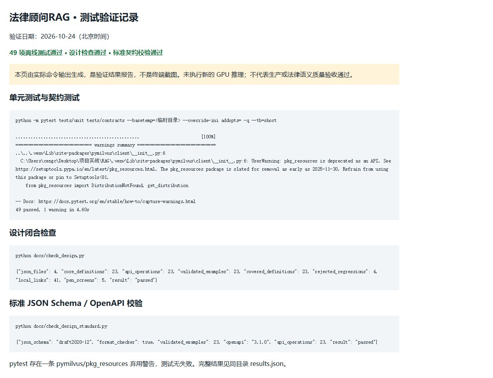

# 法律顾问RAG

面向劳动用工咨询的单人本机演示项目。支持法规与案例导入、解析切片、向量与图谱混合检索、证据引用、流式回答和知识关联浏览；包含 Qwen3-8B SFT/LoRA 训练、评估、模型导出与接入代码。

## 交付范围与状态

核心包包含 FastAPI 后端、后台 worker、网页前端、模型适配器、训练评估脚本、测试、设计契约和中间件编排。模型权重、训练语料、本地数据库、密钥和服务器连接记录不在包内。

本机及真实模型的集成已验证；最近 6 条场景及追问中 5 条引用通过，1 条存在重复且缺引用，仍需质量优化与独立法律语义评审。本项目当前为单人演示版本，生产部署还需鉴权、访问控制、运维及质量验收。

## 测试截图

[查看测试截图与验证范围](docs/测试截图.md)：包含历史真实模型回答、证据引用，以及 2026-10-24 的 49 项离线测试和契约检查结果。



## 启动

业务程序使用 Python 3.11、uv 和 Docker。复制本项目到任意目录后，在项目根目录执行：

```powershell
uv sync --extra embedding --no-editable
Copy-Item .env.example .env
docker compose -f deploy/compose.yml up -d
uv run python -X utf8 scripts/preflight.py --mode offline
uv run python -X utf8 scripts/preflight.py --mode live
uv run uvicorn legal_rag.api.main:app --host 127.0.0.1 --port 8100
```

填写 `.env` 中的中间件凭据后运行预检。`deploy/seaweedfs-s3.json` 和 compose 中的凭据为仅限本机演示的示例值；示例环境变量留空的密码需与配置匹配。首次嵌入模型下载需要网络。

另开终端启动任务消费者：

```powershell
uv run python -X utf8 -m legal_rag.worker.main
```

打开 <http://127.0.0.1:8100>。如果设置了系统代理，为程序设置 `NO_PROXY=127.0.0.1,localhost,::1`。

## 回答模型与微调

需要自行部署兼容 OpenAI API 的模型服务，并填写 `LLM_BASE_URL`、`LLM_API_KEY`、`LLM_MODEL`、`MODEL_DEPLOYMENT_MANIFEST` 和 `MODEL_TOKENIZER_PATH`。

模型不可用时返回 `MODEL_SERVICE_UNAVAILABLE`。资料导入后需由 worker 完成索引与发布，列表出现 queued 表示等待处理。

训练在独立 Linux GPU 环境运行，依赖见 `training/requirements-qwen3.txt`；BF16 LoRA 与 24GB 卡的适配需先运行显存探针。训练语料需按文档从已授权公开来源准备，包内不含训练语料或权重。

- [微调与部署操作](docs/08_Qwen3-8B微调与接入操作.md)
- [总体架构](docs/01_总体架构与处理流程.md)
- [数据与接口契约](docs/02_数据与接口契约.md)
- [设计总纲](掌柜智库_概要设计总纲.md)

## 验证

```powershell
uv run pytest tests/unit tests/contracts
uv run python -X utf8 docs/check_design.py
uv run python -X utf8 docs/check_design_standard.py
uv run pytest tests/integration
```

集成测试需要相应中间件；模型训练和真实推理需要额外模型文件及服务。离线测试通过不代表已验证生产可用性。
